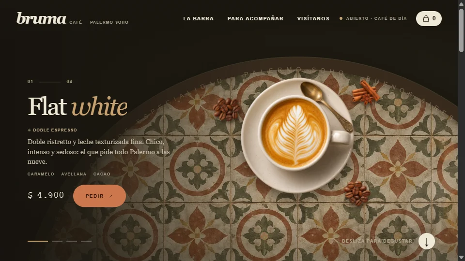

# Bruma Motion Lab

**Six web animation techniques. One interactive café experience.**

An educational, dependency-free motion design playground that explores how animation can communicate state, guide attention and provide feedback in a realistic product interface. Inspired by the six-effect café demo shared by [@capazeroo](https://www.tiktok.com/@capazeroo). Independently reconstructed from the visual reference; not the original site's source code or an official café website.

[](https://vercel.com/new/clone?repository-url=https%3A%2F%2Fgithub.com%2FVKevinxz%2Fbruma-motion-lab)

**Live demo:** deployment URL pending. The repository is configured for Vercel; this link will be updated once the production domain is confirmed.



## What this project demonstrates

Motion isn't just decoration. Each interaction has a purpose: explain a spatial relationship, connect content and state, offer tactile feedback or confirm an action. The six techniques work together in a small ordering flow.

| Technique | What it contributes | Implementation |
| --- | --- | --- |
| Scroll-driven carousel | Turns a flat product list into a spatial, reversible exploration | Sticky scene, scroll progress, requestAnimationFrame, transforms |
| Split text | Introduces the selected product and guides attention | Character spans, masked overflow, CSS keyframes, 22 ms stagger |
| Odometer | Makes a price change legible and connects it to product state | Vertical digit strips, translateY |
| Magnetic button | Draws attention and responds to pointer movement | Pointer events, bounded translation, easing |
| Hover image reveal | Offers a product preview without navigating away | Circular clip-path, smoothed cursor tracking |
| Fly to cart | Makes the result of adding a product explicit | Web Animations API, sinusoidal trajectory, rotation and scale |

## Explore the page

1. Scroll through Flat white, Cortado en jarrito, Cold brew de naranja and Submarino. You can also select a drink using the indicators.
2. Move the pointer over the order button to experience the magnetic effect.
3. Open **Pedir**, select the available drink options and add the product. Watch it fly to the bag.
4. Visit **Para acompañar** and hover over the pastries. On touch screens, tap to open product details instead.
5. Open the bag, change quantities and inspect the total. Orders are simulated; there is no payment integration.

## Built with

- Semantic HTML and native dialog.
- CSS custom properties, sticky positioning, transitions, keyframes, transforms and clip-path.
- Vanilla JavaScript, Pointer Events, requestAnimationFrame and Web Animations API.
- LocalStorage for a persistent demo cart.
- Optimized WebP product assets with transparent backgrounds and a tiled texture; editable SVG tile fallback.
- Responsive layout, keyboard-accessible controls and reduced-motion support.

No framework, runtime dependency, external API, npm install or build step is required.

## Run locally

```bash
git clone https://github.com/VKevinxz/bruma-motion-lab.git
cd bruma-motion-lab
python -m http.server 8765 --directory bruma-demo --bind 127.0.0.1
```

Open http://127.0.0.1:8765/. Python 3 is only needed for this example local HTTP server; any static file server works.

## Learn from the implementation

```text
bruma-demo/
  index.html       Semantic page, hero, menu and product drawer
  styles.css       Visual system, masks, keyframes and responsive rules
  app.js           Product data, scroll geometry, input events and cart
  assets/          Optimized images and tile SVG
vercel.json         Static deployment configuration
```

In `app.js`, start with `geometry()`, `render()`, `tick()` and `updateTarget()` for the carousel. `setTitle()` and `setPrice()` handle the content transitions. The magnetic region and sweet-menu listeners handle pointer effects; `fly()` creates the cart animation. Customize the `drinks` and `sweets` arrays to reuse the experience with another catalog.

## Deploy on Vercel

Import this repository at [Vercel](https://vercel.com/new). Use the repository root, framework preset **Other**, no install or build command, and output directory **bruma-demo**. These defaults are recorded in `vercel.json`. No environment variables are needed. After production deployment, replace the pending live-demo line above with the confirmed URL.

## Reference and scope

The project is a reconstruction for learning frontend animation. The original reference video and extracted frames are not distributed in this repository. The current visual assets were supplied separately by the project owner; the original code, visual identity and reference creator are not claimed as our own. Product content and checkout are illustrative, not a real store. Timing and layout are interpreted, not a pixel-perfect reproduction.

## License

A code license has not yet been selected. The reference creator and third-party visual identity retain their respective rights. Asset redistribution and commercial reuse are subject to their applicable terms; a public repository does not by itself grant a reuse license.
